# Addon Manager for Lossless Scaling - REDUX

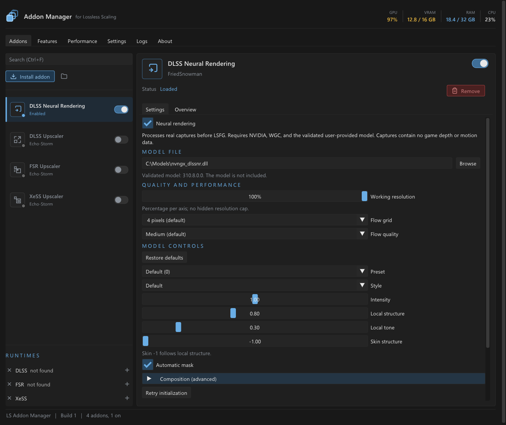

- **Completely new DLSS5 implementation**
- Removed the update check (the app is completely offline)
- Bug fixes
- It's blue because I like blue

## New DLSS5 addon

The old addon had some serious architectural problems and didn't match the visuals of the other established projects. The DLSS5 addon has been replaced with a new NVIDIA-only implementation in [addons/NeuralRendering](addons/NeuralRendering).

### New Architecture

```text
Game output
    -> NVIDIA Optical Flow between original captures
    -> one DLSS Neural Rendering evaluation
    -> OptiScaler compositor
    -> completed enhanced real frame
    -> LSFG motion analysis and frame generation
    -> presentation
```

**Neural rendering now finishes before LSFG analyzes the frame.** The manager exposes a real-frame processing hook, and LSFG receives the completed enhancement as its input. Generated frames are interpolated from those enhanced real frames; the addon never runs the model on a generated frame or carries an older neural edit onto a newer image. With frame generation off, the same processing happens before the copy/NIS stage. The standalone upscalers still run later at NIS.

Motion comes from **NVIDIA Optical Flow**, comparing the current original capture with the previous accepted original capture. The addon queries the hardware capabilities and converts the vectors into pixels at the model's working resolution. It does not extract LSFG's internal flow textures, and enhanced or generated images never become inputs to its motion estimator.

The **compositor is OptiScaler's DLSS NR composition shader. It handles the SDR/scRGB colour conversion, reconstruction at reduced working resolutions, detail/colour transfer and luminance bounds. Any residual it reconstructs belongs to the same frame. The model forwarder is also adapted from that revision. RenoDX-derived colour work is credited in the [source notices](addons/NeuralRendering/NOTICE.md); the [shader](addons/NeuralRendering/third_party/optiscaler/dlssnr.hlsl) and licences are included with the addon source.

### What was wrong with the old path?

The retired `DLSS5NR01` addon evaluated the model asynchronously, saved the difference between its result and the source image, then warped the newest completed difference onto real and generated frames at **Present**. That reduced how often presentation had to wait, but introduced several problems:

- **An edit could belong to an older frame.** Warping could move it with estimated motion, but could not make newly revealed surfaces, changed content or a scene cut match the frame that produced it. This created opportunities for trailing and misplaced detail.
- **LSFG analyzed the picture before the neural edit.** Its interpolation could not account for changes added afterward. The new ordering gives LSFG the enhanced real frames for both analysis and interpolation.
- **Capture and output coordinates could disagree.** The replacement processes the capture itself, removing the late overlay mapping step.
- **The compositor needed its own colour and HDR fixes.** The old changelog records the bright orange/cyan highlight problem and its fix. The new path uses a pinned OptiScaler compositor with independent parity tests instead of extending that custom delta-composition chain.

### Benefits, requirements and limits

The main benefits are **a result tied to the current real frame**, **LSFG interpolation of the enhanced image**, and **a compositor whose output is checked against its pinned upstream implementation**. Resizes, capture restarts, sequence gaps and detected cuts reset history. The panel exposes effective dimensions, GPU stage timings and bypass counts so it is possible to see when the pipeline cannot keep up.

That ordering has a cost: LSFG waits for the accepted frame's NR work on the GPU. There is also a bounded CPU wait for a small scene-change summary. This is not a zero-latency path.

Use **WGC**, an NVIDIA GPU with compatible optical-flow/model support, and **LSFG 3 or frame generation off**. With FG off, select Scaling Off or NIS. The supported runtime profile is LS **3.2.2.0** with the user-provided NR model **310.8.0.0**; exact hashes and setup are in the [new addon guide](addons/NeuralRendering/README.md). Unknown builds bypass unchanged. SDR and linear scRGB are supported; direct HDR10/PQ capture is not. Captures supply no game depth, exposure, jitter or engine motion vectors; the validated model uses constant placeholder depth.

## Fork notice

Fork of https://github.com/Echo-Storm/ls-addon-manager
Original repo and GitHub were nuked, and then their Reddit got nuked as well. The code doesn't seem malicious at all, so maybe they just got fed up and retired? A real shame because it works EXTREMELY well.

---
---

<!-- <p align="center">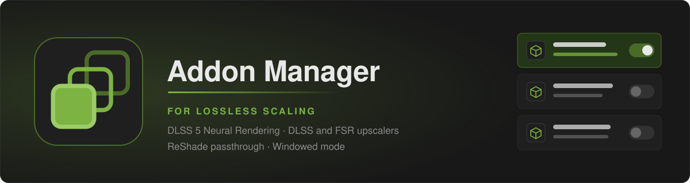</p> -->

<p align="center"><b>Lossless Scaling, extended.</b><br>DLSS 5 Neural Rendering, DLSS, FSR and XeSS upscaling for games that never had them, and an addon manager that keeps it all in one window.</p>

<!-- <p align="center">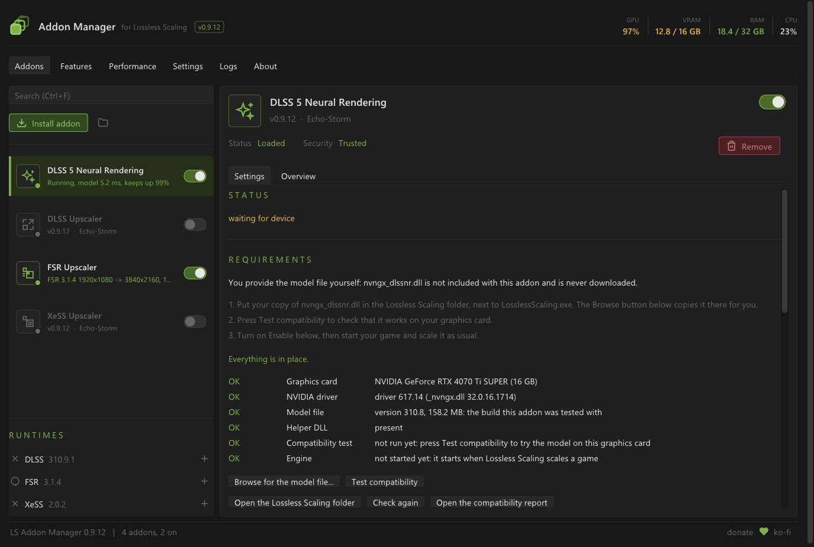</p> -->

**Addon Manager for Lossless Scaling** loads alongside [Lossless Scaling](https://store.steampowered.com/app/993090/Lossless_Scaling/) and gives it an addon system,
with source for four addons that do what Lossless Scaling alone cannot:

- ~~**DLSS 5 Neural Rendering** gives any game a new look, on every frame Lossless Scaling shows.~~ **DLSS Neural Rendering** now enhances real captures before LSFG, as described [above](#new-neural-rendering-dlssnr02).
- The **DLSS**, **FSR** and **XeSS Upscalers** put a real temporal upscaler in place of Lossless Scaling's NIS scaler, so games that never had one get one.

Around them, the manager installs and switches addons, shows the machine's load at a glance, explains what limits your frame rate, backs every setting up and
supports manual installation. It is free and unofficial: not affiliated with the Lossless Scaling developers. The manager is MIT-licensed; the new Neural Rendering addon is GPL-3.0-only. Read the [disclaimer](DISCLAIMER.md) before installing.

[Build workflow](.github/workflows/build.yml)
&nbsp; **0.9.15 upstream baseline**, ~~on the way to 1.0 (roadmap)~~ &nbsp;·&nbsp; Lossless Scaling 3.2.2.0 &nbsp;·&nbsp; Windows 10 or 11, x64

> [!TIP]
> ~~**New in 0.9.15:** Neural Rendering in HDR without the neon orange and cyan in bright areas.~~ This was a fix for the retired NR compositor.
> **0.9.14:** the upscalers in motion, a very big improvement: much less trailing and smearing while you walk and turn, no flicker at the
> screen's own size with DLSS (the new **Auto** model), and all three now beat a plain stretch in a fast turn, for 3-4 ms a frame at 4K.
> Everything else is in the [changelog](CHANGELOG.md).

<!-- <p align="center">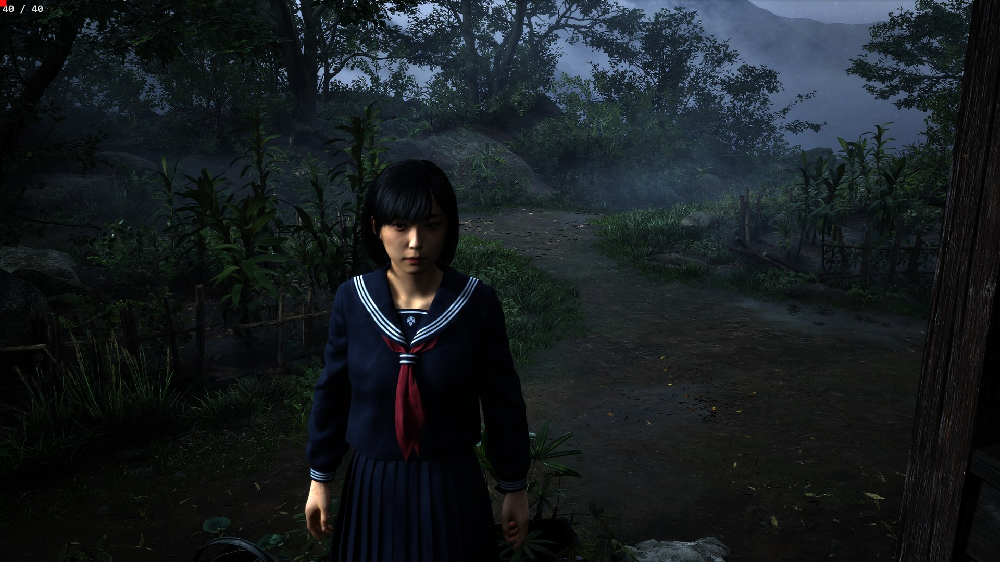</p> -->
<!-- <p align="center">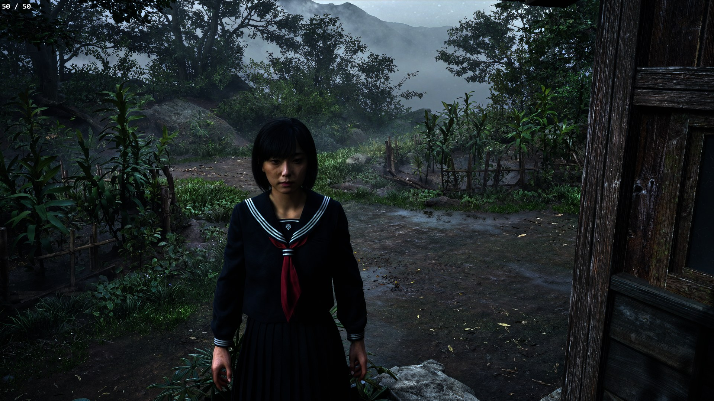</p> -->
<!-- <p align="center"><sub>Silent Hill f (Unreal Engine 5, HDR) through Lossless Scaling: the original above, DLSS 5 Neural Rendering below.</sub></p> -->

> [!IMPORTANT]
> **DLSS 5 Neural Rendering needs a file you provide yourself:** your own copy of `nvngx_dlssnr.dll`. It is **not included**, this project **never downloads it**,
> and it does not say where to get it. ~~Put it next to `LosslessScaling.exe` (Setup and the addon's **Browse for the model file...** button can copy it there), then press **Test compatibility** in the addon's panel.~~
> Select an existing model with **Browse** in the new addon panel. It checks compatibility automatically and does not copy the file. Everything else, the upscalers included, works without it.

**Upstream tested with** World of Warcraft: Forever, Fallout: New Vegas (Tale of Two Wastelands), Silent Hill f (HDR) and Metro 2033 Redux, on an NVIDIA RTX GPU and
Windows 11. These are historical upstream reports, not validation of the replacement NR addon; reports for this fork are welcome.

## Contents

- [New Neural Rendering](#new-neural-rendering-dlssnr02): architecture, changes, requirements and limits
- [Install](#install)
- [The addons](#the-addons): [Neural Rendering](#dlss-5-neural-rendering), [the upscalers](#the-upscalers-dlss-fsr-and-xess), [built-in features](#built-in-features)
- [The manager](#the-manager) · [Hotkeys](#hotkeys) · [Updates](#updates) · [If something goes wrong](#if-something-goes-wrong)
- [For developers](#for-developers): how it works, building, writing an addon · [Credits](#credits)

## Install

1. ~~Build this checkout following LOCAL_BUILD.md. This produces the manager and Neural Rendering in a new `build/local-nr-<id>/package` folder, without a Setup executable or the optional upscalers.~~ Build the manager and new NR addon with the commands under [Building](#building).
2. Close Lossless Scaling and open its folder (for Steam, for example `C:\Program Files (x86)\Steam\steamapps\common\Lossless Scaling`).
3. **First time only:** rename its `Lossless.dll` to `Lossless_original.dll`. Keep it: the manager forwards to it. If the manager is already installed, keep the existing `Lossless_original.dll`.
4. ~~Copy the generated package's contents into the Lossless Scaling folder, merging its `addons` folder with any existing one. The package contains no saved user configuration.~~ Copy `manager/build/Release/Lossless.dll` and the two `manager/manager-icon` files (`.ico` and `.png`) into the LS folder. Create `addons/DLSSNR02` there and copy `DLSSNR02.dll` and `NeuralRendering_nvngx.dll` from `addons/NeuralRendering/build/Release`. Add `addon.json`, `icon.svg`, `README.md`, `NOTICE.md`, `LICENSE` and the `licenses` directory from `addons/NeuralRendering`, plus the generated `build/NeuralRendering-source.zip`. Preserve existing settings and model files.
5. Start Lossless Scaling. The manager opens by itself. On a new installation, Neural Rendering is enabled; ~~provide the model file described above and press **Test compatibility**~~ select your model with **Browse**, choose WGC and follow the [supported profile](#benefits-requirements-and-limits).

**Updating:** build the new source, close Lossless Scaling, and copy the rebuilt files using the same layout, keeping `Lossless_original.dll` and your settings. The new manager ignores old NR plugin folders; its local installer also backs up their owned executables on upgrade.
**After a Lossless Scaling update:** if it replaced the manager's `Lossless.dll`, move the stale `Lossless_original.dll` aside, rename the new `Lossless.dll` to `Lossless_original.dll`, and copy the manager's files in again.
**Uninstalling:** close Lossless Scaling, delete the manager's `Lossless.dll`, and rename `Lossless_original.dll` back to `Lossless.dll`. Keep `addons` if you want to preserve its settings, or remove it too.

<details>
<summary><b>Building your own Setup (optional)</b></summary>

The broader packaging route can build `LSAddonManagerSetup.exe` locally. Fetch the required vendor dependencies listed under [Building](#building), then run:

```powershell
powershell -NoProfile -File tools/package.ps1
```

It writes `dist/LSAddonManager-build-<number>-x64.zip`, containing Setup and the package documentation. Close Lossless Scaling and run the Setup you built.
It finds your Lossless Scaling folder (Steam or not; otherwise choose **Use a different folder...**) and offers what fits: **Install**, **Update**, **Repair** or **Uninstall**.
The current packaging script requires all four addon products; Neural Rendering starts on, and included upscalers start off on a new installation.

<!--
<table>
<tr>
<td valign="top" width="50%"><b>Setup, before installing</b><br>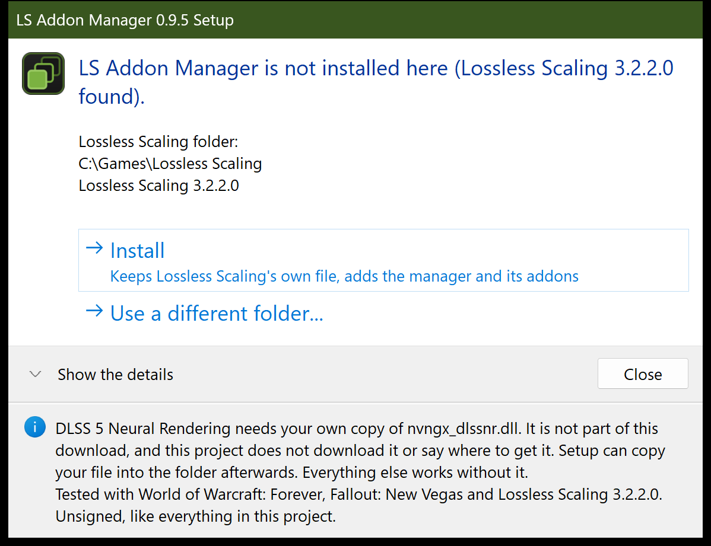</td>
<td valign="top" width="50%"><b>Setup, when it is done</b><br>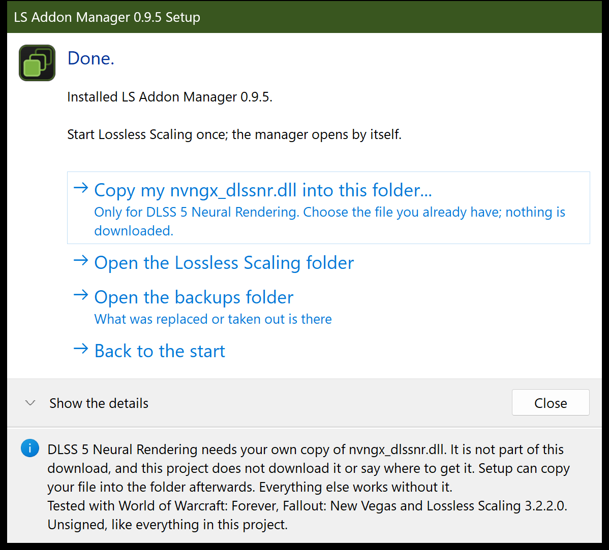</td>
</tr>
</table>
-->

**What Setup does:**

- Keeps Lossless Scaling's own `Lossless.dll` as `Lossless_original.dll` (the manager forwards to it) and puts ours in, with the `addons` folder.
- **Backs up everything it replaces** into a `backups` folder, checks every file after copying, and puts the folder back as it was if anything fails.
- **Never touches your settings** or your other addons, and refuses to run while Lossless Scaling runs from that folder.
- After a **Lossless Scaling update** (which may put its own `Lossless.dll` back), run it again: it offers **Repair**.
- Asks for administrator rights only when the folder needs them (Program Files, for example).

Locally built Setup is **unsigned**, so Windows SmartScreen may warn you. Its source is in [`installer/`](installer/).

To install its contents by hand, run `LSAddonManagerSetup.exe --extract files` in the unzipped folder. It writes the bundled files into a new
`files` folder; use those files in the manual installation steps above.
</details>

## The addons

| | What it does | Needs | Starts |
|---|---|---|---|
| ~~**DLSS 5 Neural Rendering (DLSS5NR01)**~~ | ~~NVIDIA's neural rendering model on every frame Lossless Scaling shows: a new look for any game~~ | ~~NVIDIA RTX, your own model file~~ | retired |
| **DLSS Neural Rendering (DLSSNR02)** | Enhances real captures before LSFG analyzes and interpolates them | Compatible NVIDIA GPU, WGC, your own supported model file | on |
| **DLSS Upscaler** | NVIDIA DLSS in place of NIS: upscaling, or DLAA at the screen's own size | NVIDIA RTX | off |
| **FSR Upscaler** | AMD FSR 3.1 or FSR 4 in the same place | any DirectX 12 card | off |
| **XeSS Upscaler** | Intel XeSS in the same place | any card with Shader Model 6.4 | off |

The recommended NR-only build includes only the manager and Neural Rendering. To include the optional upscalers, fetch their vendor dependencies and use the broader build and packaging route under [Building](#building).
That package includes the runtimes needed by the upscalers it contains. Only one upscaler runs at a time; any of them works beside Neural Rendering.

### DLSS 5 Neural Rendering

**Historical DLSS5NR01 behavior.** The replacement is described [above](#new-neural-rendering-dlssnr02).

~~Runs NVIDIA's DLSS 5 neural model on Lossless Scaling's frames and applies the latest available result to **real and generated frames**. Model evaluation runs on its own worker thread; synchronization can still involve short waits.~~

- ~~**Frame generation on or off.** With it on, the model's result is carried onto the generated frames along the motion; with it off, the model takes the presented frames.~~
- ~~**Its own motion measurement**, per pixel, so the picture holds together while the camera turns.~~
- ~~**Looks:** saved sets of sliders, a look per game that follows the game in focus, and a hotkey to cycle them.~~
- ~~**Keep the HUD untouched:** draw the areas the model must leave alone (action bars, chat, the minimap) on a snapshot of the game.~~
- ~~**Picture controls:** intensity, fine detail, local contrast, skin detail, sharpening, tone, colour, shadows and highlights, film grain, temporal smoothing,   and a ghost guard where the motion cannot be trusted.~~
- ~~**HDR games** (scRGB and HDR10), with only the model's change put back, so highlights keep their brightness.~~
- ~~**Compare while you play:** before / after, a split view, and before / after pictures (see [Hotkeys](#hotkeys)).~~
- ~~**Auto quality** keeps the model within a time budget; a **compatibility test** tries the model on your card before you play.~~

Upstream measured about 5 to 9 ms a frame on an NVIDIA RTX GPU with a 1912x1080 model input (8.5 ms at 4K in World of Warcraft). ~~The retired addon's README has the details.~~ These timings do not describe the replacement.

<!-- <p align="center">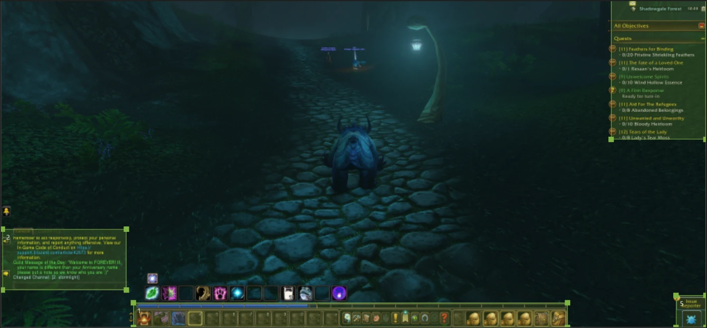</p> -->

### The upscalers: DLSS, FSR and XeSS

<!-- <p align="center">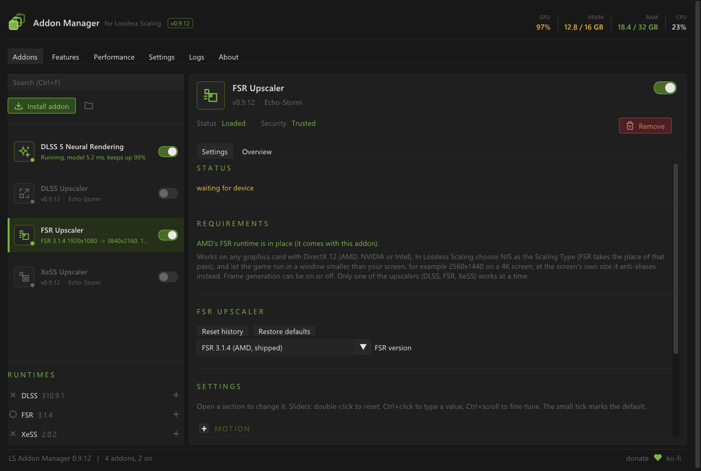</p> -->

Lossless Scaling scales a game window up to the screen one frame at a time. The upscalers put a **temporal upscaler** in its place: it reads several frames and
the motion between them, for a steadier, more detailed picture. The game needs no support for it: **the addons measure the motion from the frames themselves.**

**To use one:** switch it on in the addon list, choose **NIS** as the Scaling Type in Lossless Scaling, and run the game in a window smaller than the screen
(for example 2560x1440 on a 4K screen). At the screen's own size it anti-aliases instead.

| | DLSS | FSR | XeSS |
|---|---|---|---|
| Runs on | NVIDIA RTX | any DirectX 12 card | any card with Shader Model 6.4 (Intel Arc, NVIDIA, AMD) |
| Versions | **Auto** (the default: model E at the screen's own size, L when upscaling), or K, L, J (DLSS 4), M (DLSS 4.5), E (DLSS 3) | FSR 3.1.4 (AMD's, signed) or FSR 4.1.1b (the OptiScaler team's build, on any card) | XeSS 2.0.2 (Intel's, signed) |
| Good at | smoothing edges | FSR 3: low cost, crisp text; FSR 4: motion | on Intel Arc it runs on the card's matrix units |
| Sharpening | ours | AMD's RCAS, ours above it | ours |

**Which one?** On an NVIDIA RTX card, try DLSS and FSR 4. On any other card, FSR, and XeSS on Intel Arc. Upstream tried all three in World of Warcraft.

What all three do:

- **Every presented frame**, real and generated, with frame generation on or off.
- **HDR games** (scRGB and HDR10) in the upscaler's own HDR mode, highlights kept; *Frame encoding* overrides the automatic choice.
- **4:3 and other window shapes**, upscaled into the part of the screen Lossless Scaling uses, borders left alone.
- **Steady in fast motion:** Lossless Scaling gives an upscaler none of the camera jitter a game gives it, so in motion its memory of
  earlier frames only trails; where the picture moves, ours leans on the new frame (**Lean from** sets from how much motion).
- **Stability** (less shimmer on wires and leaves), **edge smoothing** for games without anti-aliasing, and **sharpening** well past the upscaler's own.
- **Colour and tone** (vibrance, saturation, shadows, highlights, brightness, contrast, gamma), applied before upscaling, so they cost nothing.
- **Settings per game**, which come back when the game takes focus.
- **Before / after** against NIS while you play, and a line of live numbers.

Upstream measurements on an NVIDIA RTX GPU, everything included (the 1:1 row: 0.9.14, live in World of Warcraft, the motion estimate included):

| | DLSS | FSR 3.1 | XeSS |
|---|---|---|---|
| 1920x1080 -> 3840x2160 | | about 1.5 ms | not measured yet |
| 2560x1440 -> 3840x2160 | about 2.4 ms | about 1.85 ms | not measured yet |
| 3840x2160 at 1:1 (anti-aliasing) | about 4.2 ms (model E) | about 3.3-3.7 ms | about 2.7-2.8 ms |

FSR 4 costs more than FSR 3.1; the panel's status line shows what it takes on your card. If the game has its own anti-aliasing (MSAA), switch it on: it
draws what no upscaler can put back. The [upscalers' guide](addons/Upscalers/docs/upscalers.md) covers every setting.

### Built-in features

Built into the manager, on its Features tab, both off until switched on:

- **ReShade input passthrough:** mouse and keyboard reach a ReShade overlay while Lossless Scaling scales the game. **Home** turns it on and off.
- **Windowed mode and second monitor:** a virtual display the size of your game window, so Lossless Scaling works with a windowed game or on a second
  monitor, with split-screen and side-by-side options. Switching it on needs a restart of Lossless Scaling.

## The manager

- **The machine at a glance:** the header shows the graphics card's load and memory, system memory and the processor, on every tab.
- **A Performance tab that explains itself:** frame rate and frame times, what each addon costs, the GPU's load, power, clocks, temperature and memory, and a
  plain-words reading such as "the GPU is at its power limit".
- **Addons without touching folders:** install from a folder, a zip or a DLL (or drop one on the window); *Remove* moves an addon aside, nothing is erased.
- **Runtimes list:** every file the addons run on (DLSS, FSR, XeSS, your model), whether it is available, and whether it is loaded.
  **+** switches to another file while the game runs.
  <!-- <p align="center">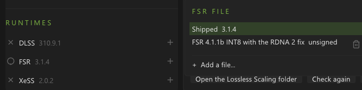</p> -->
- **Record a bug:** the standalone upscalers keep the last few seconds of frames and save them as a file that plays the problem back on another computer. The replacement NR addon does not include the old recorder.
- **Stays out of the way:** it opens with Lossless Scaling, hides to the notification area, and comes back with a click or **Ctrl+Shift+F12**.
- **Back up and restore** every setting to one file, and a **diagnostics zip** of logs and settings for a bug report (nothing is uploaded).
- **Recovery:** addon callback faults are caught and settings are written atomically.
- **Interface size** from 75% to 200%, sharp on any display.

| Tab | What is on it |
|-----|--------------|
| **Addons** | The addon list with a switch, icon and live status for each, the Runtimes list, and the chosen addon's settings |
| **Features** | ReShade input passthrough and Windowed mode |
| **Performance** | Frame times, addon cost, GPU load, power, clocks, temperature, memory, and what is limiting you |
| **Settings** | Backup and restore, interface size, start-up and hotkey, log detail, the diagnostics file |
| **Logs** | The last 10,000 log entries, filtered by level |
| **About** | What comes with it, usage tips, credits, and notes for addon authors |

Closing the window stops nothing: the manager hides to the notification area (Windows may keep its icon under the ^ arrow by the clock).

<!--
<table>
<tr>
<td valign="top" width="50%"><b>Performance</b><br>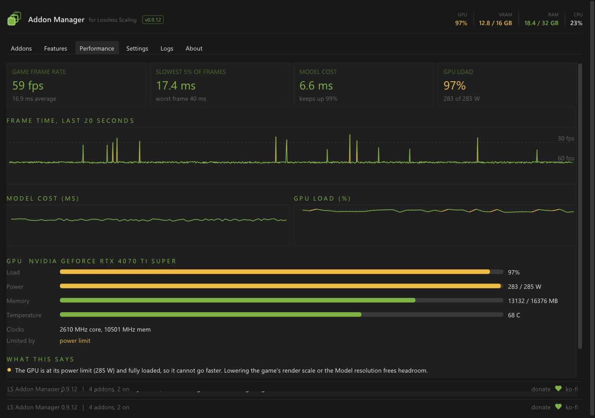</td>
<td valign="top" width="50%"><b>Settings</b><br>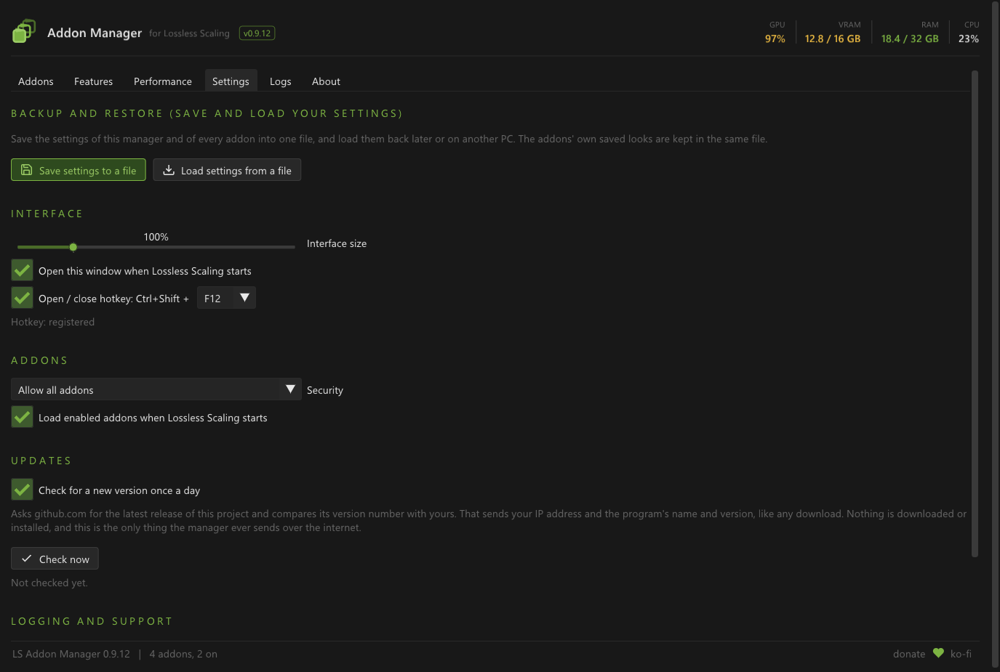</td>
</tr>
</table>
-->

## Hotkeys

The replacement NR addon uses **Apply model result** in its panel for comparison. Its retired hotkeys are struck through below; the manager and standalone upscaler shortcuts remain available.

They work while the game has focus. The game sees the key too, so the defaults keep away from keys games often use alone (F5, F6, F9, F11). If one
clashes in your game, change it in the addon's *Compare and hotkeys* section.

| Keys | What they do | Where |
|------|--------------|-------|
| Ctrl+Shift+F12 | Show or hide the manager | the manager |
| Ctrl+Shift+F7 | Before / after: the original (or NIS) against ours | ~~every addon~~ standalone upscalers |
| ~~Ctrl+Shift+F8~~ | ~~Split view: the original at the left, ours at the right~~ | ~~Neural Rendering~~ |
| Ctrl+Shift+F2 / F3 | Sharpening down / up | ~~every addon~~ standalone upscalers |
| Ctrl+Shift+F4 | Before / after pictures: two PNGs of the same moment, with and without the addon | ~~every addon~~ standalone upscalers |
| ~~Ctrl+Shift+F10~~ | ~~The next saved look~~ | ~~Neural Rendering~~ |
| Ctrl+Shift+F1 | Save the recording (the last few seconds, with *Recording* on in that addon: each addon has its own) | ~~every addon~~ standalone upscalers |
| Home | ReShade input passthrough on and off | the manager |

## Updates

This fork has no release polling, download worker, update prompts, or automatic installer handoff. Old update settings are inert. To change versions, review the new source and build it locally. The local installer's explicit install, repair and uninstall operations remain available.

## If something goes wrong

| What you see | What to do |
|--------------|-----------|
| The manager does not appear | It may be hidden: look under the ^ arrow by the clock, or press Ctrl+Shift+F12. If not, a Lossless Scaling update may have put its own `Lossless.dll` back: follow the repair steps under [Install](#install), or choose **Repair** in a locally built Setup. |
| Setup says Lossless Scaling is running | Close it (also from its notification-area icon), then press **Check again**. |
| Setup does not find your Lossless Scaling folder | Choose **Use a different folder...** and pick the folder that holds `LosslessScaling.exe`. Setup remembers it. |
| SmartScreen or your antivirus objects to a file | The files are not signed. ~~If your antivirus removes `nr_selftest.exe`, only *Test compatibility* stops working.~~ That helper belonged to the retired addon. |
| Neural Rendering says the model file is missing | It needs your own `nvngx_dlssnr.dll`: ~~use **Browse for the model file...**, then **Test compatibility**~~ select the supported model with **Browse**. Check the panel status; its default search location is beside `LosslessScaling.exe`. |
| An upscaler is on but the picture looks like NIS | Choose **NIS** as the Scaling Type in Lossless Scaling. The panel's status line says what the upscaler is doing. |
| The DLSS Upscaler names a card that is not NVIDIA's | Lossless Scaling runs on that card. Set its **Preferred GPU** to your NVIDIA card, or use the FSR or XeSS Upscaler, which run on any card. |
| FSR 4 looks wrong, costs too much or does not start | Set **FSR runtime** back to **FSR (AMD, shipped)** in the FSR Upscaler's panel, or choose **Shipped** in the Runtimes list. The bundled default is FSR 3.1.4. A chosen file that goes missing falls back to the shipped one by itself. |
| An addon says its runtime "stopped responding" | Lossless Scaling carries on without the addon. Choose another runtime with **+** in the Runtimes list, restart Lossless Scaling, and send us the addon's log. |
| An HDR game looks washed out, too dark or too bright | Set **Frame encoding** (the bottom of the Upscaling section) to HDR or SDR by hand, and tell us which it needed. |
| ~~Neural Rendering turns bright areas neon orange or cyan in HDR~~ | ~~Fixed in 0.9.15: update.~~ Historical fix for the old compositor; the replacement uses OptiScaler composition with SDR/scRGB capture. |
| Windowed mode does nothing | Restart Lossless Scaling after switching it on: its virtual display must exist before Lossless Scaling starts. |
| Something looks wrong in a game | For a standalone upscaler, turn on *Recording*, reproduce the problem, press **Ctrl+Shift+F1**, and attach the `.lsrec` file (in `Videos\Lossless Scaling`). ~~Each addon has its own recorder.~~ For the replacement NR addon, include the manager log, capture mode and settings with your report. |
| Anything else | See the [questions and answers](docs/faq.md). To report a bug, make a **diagnostics file** on the Settings tab. To uninstall, follow the steps under [Install](#install), or choose **Uninstall** in a locally built Setup. |

<details>
<summary><b>The files it keeps</b></summary>

All inside the Lossless Scaling folder, except the recordings.

| File | What |
|------|------|
| `addons\config.json` | Every addon's state and settings, and the manager's. Written atomically; an unreadable one is kept as `config.json.corrupt`. |
| `addons\.removed\` | Addons you removed, each in a folder with a timestamp. |
| `addons\<addon>\runtimes\` | Runtime files added with **+** in the Runtimes list (and the FSR 4 build), one folder each. Updates leave them alone. |
| `backups\` | What Setup replaced, and settings saved before a restore replaced them. |
| `logs\` | `LSAddonManager.log` (including the new NR status/timing messages) and the standalone upscaler logs (`DLSS4DLAA.log`, `FSR3UPSC.log`, `XESSUPSC.log`); ~~`DLSS5NR01.log`~~ belongs to the retired addon. The manager's log rolls over to `.old` at 8 MB. |
| `Videos\Lossless Scaling\*.lsrec` | Recordings, in your Videos folder. |
</details>

## For developers

### How it works

```
LosslessScaling.exe
  └─ loads Lossless.dll          <- the manager, in the original's place
       ├─ loads Lossless_original.dll (the real engine) and forwards its exports untouched
       ├─ watches Direct3D 11 compute work and shader loading, for addons that ask
       ├─ loads the addons from addons\
       └─ draws its window with Dear ImGui on its own thread
```

Nothing in Lossless Scaling is patched on disk, and removing the manager puts everything back. Addons share the manager's Dear ImGui context, so their
settings appear inline in the same look.

The addons run model evaluation and upscaling on a Direct3D 12 device of their own, beside Lossless Scaling's Direct3D 11 one, sharing textures and fences.
~~NVIDIA's, AMD's and Intel's evaluation code runs on worker threads. Synchronization includes GPU waits and bounded CPU waits; for example, Neural Rendering's bridge can wait up to 2 ms for an idle worker and 4 ms for a submission.~~
~~Neural Rendering hooks the frame Lossless Scaling captures or presents and composes the result with Direct3D 11; the upscalers recognise its NIS pass and put their picture in its output.~~

The standalone upscalers retain their NIS hook and worker-based evaluation. The new NR addon initializes/rebuilds on a worker, then submits the current capture's flow, model evaluation and OptiScaler composition before LSFG. GPU fences order D3D11 capture, D3D12 processing and D3D11 consumption; scene-change detection has a 4 ms CPU deadline. See [Architecture](#architecture) above and the [real-frame API](manager/sdk/include/eam/real_frame.h).

### Building

Visual Studio 2022 (Desktop C++) and CMake 3.20+. Dear ImGui and MinHook are fetched at pinned versions on first configure.

Releases are numbered **Build 1, Build 2, Build 3, ...**. Set `EAM_BUILD_NUMBER` in [`version.h`](manager/sdk/include/eam/version.h) for the next release; the manager, installer and package name use that number. Rebuilding keeps the same number. `tools/package.ps1 -Build 1` builds and packages Build 1, and refuses a number that differs from the source.

~~For the manager and Neural Rendering only, follow the local build guide and run `tools/build_local_nr.ps1`.~~ That build script is retired.

Build the manager and new NR addon, then create its corresponding source archive:

```powershell
powershell -NoProfile -File tools/build_all.ps1 -Only host,neural
powershell -NoProfile -File tools/package_neural_source.ps1
```

The DLLs are written to `manager/build/Release` and `addons/NeuralRendering/build/Release`; the source archive is `build/NeuralRendering-source.zip`. A Windows SDK is required. The new NR addon builds without a proprietary NGX SDK or model DLL. Its pinned public optical-flow headers and OptiScaler sources are already in the tree.

The broader build, test, packaging, and deployment tools are:

```powershell
powershell -File tools\build_all.ps1              # the manager and the addons (-Only host: the manager only)
powershell -File tools\run_addon_tests.ps1        # the offline tests for what changed (-All: everything, as before a release)
powershell -File tools\ci.ps1                     # manager, installer, NR and sample builds; tests that need no GPU
powershell -File tools\package.ps1                # the release zip, with Setup built around the files
powershell -File tools\deploy.ps1 -What all       # copy a build into a Lossless Scaling folder, with backups
```

The standalone upscalers also need their vendors' SDKs and runtimes, which are not included as binaries in this repository. The scripts fetch from the vendor's repository, or OptiScaler's for its FSR 4 build, and check what they get:

| Script | What | Licence |
|--------|------|---------|
| `tools\fetch_ngx_sdk.ps1` | NVIDIA's DLSS SDK (headers, static library, `nvngx_dlss.dll`), after you accept NVIDIA's licence | NVIDIA's |
| `tools\fetch_ffx_sdk.ps1` | AMD's FidelityFX runtime, FSR 3.1.4 (pinned SHA-256, AMD's signature); the headers are in `third_party/ffx` | MIT |
| `tools\fetch_fsr4.ps1` | FSR 4.1.1b, the OptiScaler team's build (pinned SHA-256; needs 7-Zip) | AMD's FidelityFX SDK licence |
| `tools\fetch_xess_sdk.ps1` | Intel's XeSS SDK 3.0.2 (headers, `libxess.dll`; pinned SHA-256s, Intel's signature) | Intel Simplified Software License |

~~The offline test host and its scenarios (`tools\run_hosttest_matrix.py`) exercise every addon path without Lossless Scaling or a game.~~ That matrix is retired. `tools/run_addon_tests.ps1 -Only nr -ModelPath '<path to nvngx_dlssnr.dll>'` runs the new flow, composition, model and pipeline tests on compatible NVIDIA hardware. The [tools README](tools/README.md) describes the current scripts.

### Writing an addon

**Addons written for LosslessProxy load unchanged:** the interface began as LosslessProxy's and has only grown at the end. An addon with a settings panel
should still be rebuilt against this SDK (`manager/sdk/include/eam`), since the manager pins its own Dear ImGui; if a panel faults anyway, the manager
switches that panel off instead of going down with it.

Start from the [sample addon](examples/SampleAddon), a small, tested addon with settings, a panel, a status line and a metric. Then read
[docs/addon-authors.md](docs/addon-authors.md) for the exports, the host interface and the shared look, and [docs/api-compatibility.md](docs/api-compatibility.md)
for what the 1.0 interface promises.

## Credits

This project began as [LosslessProxy](https://github.com/FrankBarretta/LosslessProxy) by **FrankBarretta**, with thanks: its proxy `Lossless.dll` with addons,
its addon interface and the ReShade and Windowed features. The manager has since been rewritten; about a tenth of its lines still match the original's.
The retired Neural Rendering addon began as **andreiday**'s DLSS 5 plugin for LosslessProxy and was rewritten and extended upstream. The new `DLSSNR02` implementation uses NVIDIA Optical Flow and the pinned **OptiScaler DLSS NR compositor and model forwarder**, with **RenoDX** colour attribution; see its [notices](addons/NeuralRendering/NOTICE.md).

The upscalers run NVIDIA DLSS, AMD FidelityFX Super Resolution (FSR 4 as built by the OptiScaler team, with thanks) and Intel XeSS; their motion measurement,
stability and edge smoothing are this project's own. The full list, with licences, is in [NOTICE.md](NOTICE.md). NVIDIA, DLSS, AMD, FidelityFX, FSR, Intel and
XeSS are trademarks of their owners; this project is not affiliated with or endorsed by them. Lossless Scaling belongs to its author; this project is unofficial.

[Manager MIT licence](LICENSE) · [NR GPL-3.0 licence](addons/NeuralRendering/LICENSE) · [Changelog](CHANGELOG.md) · ~~Roadmap~~ · [Questions and answers](docs/faq.md)
